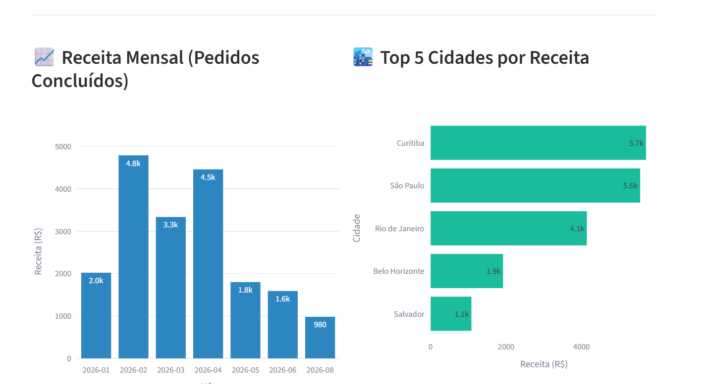

# 📊 Data Pilot — Painel de Vendas e Agente de IA

O **Data Pilot** é uma aplicação de análise de vendas construída em Python que combina visualização interativa de dados com um assistente conversacional em português. O utilizador pode explorar métricas por categoria no painel ou fazer perguntas em linguagem natural — um agente de IA decide qual função Python acionar para buscar os números reais sem inventar dados.

## 📸 Demonstração

### Painel de Vendas


### Conversa com os Dados


## 🗂️ Estrutura do Projeto

```text
data-pilot/
├── data/
│   ├── sales.csv          # Base original de vendas
│   └── sales_clean.csv    # Base tratada (separador ';' e decimal ',')
├── docs/
│   ├── painel.png         # Captura do painel principal
│   └── chat.png           # Captura do chat com tool calling
├── src/
│   ├── data_prep.py       # Limpeza, padronização e cálculo de receita com pandas
│   ├── metrics.py         # Funções de métricas de negócio
│   └── agent.py           # Integração com OpenRouter e roteamento de ferramentas
├── app.py                 # Interface web com Streamlit e gráficos Plotly
├── .env.example           # Modelo de variáveis de ambiente
├── .gitignore             # Ficheiros ignorados pelo Git
└── requirements.txt       # Dependências do projeto