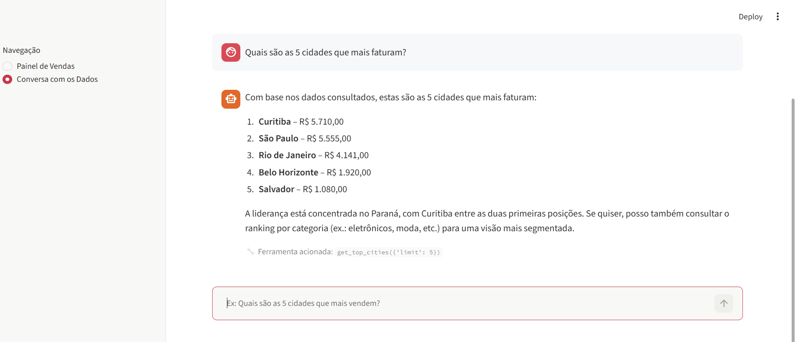

# Data Pilot

Painel de análise de vendas com um assistente que responde perguntas em português. O painel mostra métricas por categoria. No chat, um modelo de linguagem escolhe qual função Python acionar (tool calling) e consulta os números na base, em vez de estimar valores.

## Demonstração

### Painel de Vendas


### Conversa com os Dados


## Funcionalidades

- Painel com receita total, pedidos concluídos, ticket médio, clientes únicos e taxa de cancelamento, com filtro por categoria.
- Gráficos de receita mensal e das cinco cidades com maior receita.
- Chat em português. O modelo recebe a descrição de sete funções de métricas, escolhe a que responde à pergunta e redige a resposta com o valor retornado. A interface mostra qual função foi acionada.

## Tratamento dos dados

O `data_prep.py` lê `data/sales.csv` e gera `data/sales_clean.csv`. Ele padroniza datas que estavam em formatos diferentes (YYYY-MM-DD e DD/MM/YYYY), unifica as grafias do status do pedido, remove duplicatas e calcula a receita (quantidade x preço unitário). As métricas consideram apenas pedidos com status "Concluído", exceto a taxa de cancelamento, calculada sobre todos os pedidos.

## Estrutura do projeto

```text
data-pilot/
├── data/
│   ├── sales.csv          # Base original de vendas
│   └── sales_clean.csv    # Base tratada (separador ';' e decimal ',')
├── docs/
│   ├── painel.png         # Captura do painel principal
│   └── chat.png           # Captura do chat com tool calling
├── src/
│   ├── data_prep.py       # Limpeza, padronização e cálculo de receita com pandas
│   ├── metrics.py         # Funções de métricas de negócio
│   └── agent.py           # Integração com OpenRouter e roteamento de ferramentas
├── app.py                 # Interface web com Streamlit e gráficos Plotly
├── .env.example           # Modelo de variáveis de ambiente
├── .gitignore
└── requirements.txt       # Dependências do projeto
```

## Como executar

Requer Python 3.10 ou superior e uma chave de API do [OpenRouter](https://openrouter.ai).

```bash
git clone https://github.com/jeaninefgruiz/data-pilot.git
cd data-pilot
pip install -r requirements.txt
```

Copie `.env.example` para `.env` e preencha:

```text
OPENROUTER_API_KEY=sua_chave
OPENROUTER_MODEL=openrouter/free
```

Depois, inicie a aplicação:

```bash
streamlit run app.py
```

O painel funciona sem a chave. Só o chat depende dela.

## Limitações

- A base em `data/sales.csv` é pequena e de exemplo.
- O modelo padrão (`openrouter/free`) é gratuito e pode oscilar em disponibilidade e qualidade. O chat exibe uma mensagem quando isso acontece.
- O chat só responde o que as sete funções cobrem. Perguntas fora desse escopo não têm ferramenta correspondente.
- Cada métrica relê o CSV tratado. Para bases maiores seria necessário usar cache.

## Tecnologias

Python, pandas, Streamlit, Plotly, OpenAI SDK (via OpenRouter) e python-dotenv.
